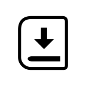

<div align="center">
  
  <h1>Simple OPDS</h1>
  <p><strong>A lightweight OPDS browser and downloader for E Ink readers.</strong></p>
  <p>
    <a href="https://github.com/yinyanfr/simple-opds/releases"></a>
    <a href="#install"></a>
    <a href="#browse-and-download"></a>
    <a href="app/src/main/res/xml/locales_config.xml"></a>
    <a href="https://github.com/yinyanfr/simple-opds/actions"></a>
    <a href="LICENSE"></a>
  </p>
  <p>
    <a href="#install"><strong>Install</strong></a> ·
    <a href="#browse-and-download">Usage</a> ·
    <a href="#build-and-test">Build and test</a> ·
    <a href="README.zh-CN.md">简体中文</a>
  </p>
</div>

Simple OPDS runs on Android 5.0 (API 21) and later, including older 32-bit ARM E Ink devices. Choose the folder where your books are saved.

The app uses native Java views, with black text and dividers on white. Catalog pages are parsed as streams, recent pages are cached with a memory limit, and books are written through a fixed-size buffer. The APK has no third-party runtime libraries or native binaries.

The interface is available in English, Simplified Chinese, and Japanese. It follows the system language by default, with English as the fallback. On Android 13 or later, change it for Simple OPDS in the system app-language settings.

## Install

Download the signed APK from [GitHub Releases](https://github.com/yinyanfr/simple-opds/releases) and open it on the reader. Official release APKs use the same signing certificate so later releases can be installed as updates.

## Browse and download

1. Tap **Add catalog (新增书库)** and enter the full OPDS URL. Enter a username and password for catalogs using HTTP Basic authentication. The app supports OPDS 1.x and 2.0 over HTTPS or HTTP. Use HTTPS for credentials whenever the catalog supports it.
2. Open a catalog and tap a book to see its available formats. Search and next-page buttons appear when the catalog advertises them. Volume and Page Up/Down keys scroll the list. At the bottom, Page Down or Volume Down opens the next catalog page when available.
3. Tap a format to download it. Choose a folder on the first download, or set it ahead of time under **Download folder (下载目录)**. On Android 11, select a subfolder such as `Documents/Books`. Android restricts selecting the storage root or the `Download` root itself.
4. Downloads continue after you leave the app. You can cancel from the download status row. Downloading a book with an existing filename saves a separate copy.

Available formats depend on the catalog. Direct EPUB, PDF, MOBI, TXT and sample links are supported. Store checkout, loan flows and DRM license links require their own client.

## Build and test

Open the repository in Android Studio, or use JDK 21, Android SDK Platform 34 and Build Tools 36.0.0. Set `ANDROID_HOME` if your SDK is outside the default location.

```sh
./gradlew :app:testDebugUnitTest :app:lintDebug :app:assembleDebug
```

The debug APK is written to `app/build/outputs/apk/debug/app-debug.apk`. The JVM tests use Robolectric and a loopback HTTP fixture to cover Atom and JSON catalogs, pagination, search, Basic authentication across redirects, filename handling, and download integrity and cancellation. The first test run downloads the test dependencies. Run `./gradlew :app:assembleRelease` to build the unsigned release APK.

## Automated releases

Every push to `main` runs tests and lint, builds and signs the APK, and attaches it to a GitHub Release. The first release of an app version uses `v<app-version>`. Later commits with the same app version use `v<app-version>-build.<run-number>`. Each tag targets the commit that triggered the run, and rerunning a workflow reuses its release.

Configure the signing key in repository Actions secrets under **Settings → Secrets and variables → Actions**. Forks should use their own key.

| Secret | Value |
| --- | --- |
| `ANDROID_KEYSTORE_BASE64` | The base64-encoded PKCS#12 release keystore with alias `simple-opds`. |
| `ANDROID_KEYSTORE_PASSWORD` | The password shared by the keystore and key. |

Keep a private backup of the keystore and password so future releases can update existing installations. Change `versionName` and increment `versionCode` in `app/build.gradle` when advancing the app version.

[MIT license](LICENSE) · [OPDS 1.2](https://specs.opds.io/opds-1.2.html) · [OPDS 2.0](https://specs.opds.io/opds-2.0.html) · [Android folder access](https://developer.android.com/training/data-storage/shared/documents-files)
