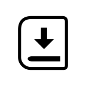

<div align="center">
  
  <h1>Simple OPDS</h1>
  <p><strong>为墨水屏阅读器打造的轻量 OPDS 书库。</strong></p>
  <p>
    <a href="https://github.com/yinyanfr/simple-opds/releases"></a>
    <a href="#安装"></a>
    <a href="#浏览和下载"></a>
    <a href="app/src/main/res/xml/locales_config.xml"></a>
    <a href="https://github.com/yinyanfr/simple-opds/actions"></a>
    <a href="LICENSE"></a>
  </p>
  <p>
    <a href="#安装"><strong>安装</strong></a> ·
    <a href="#浏览和下载">使用</a> ·
    <a href="#构建和测试">构建和测试</a> ·
    <a href="README.md">English</a>
  </p>
</div>

Simple OPDS 支持 Android 5.0（API 21）及以上版本，兼容老旧的 32 位 ARM 墨水屏阅读器。电子书可保存到你指定的文件夹。

界面使用原生 Java 控件，白底黑字，以黑线分隔。目录流式解析，近期页面使用有容量限制的缓存，下载通过固定大小的缓冲区写入。APK 无第三方运行库和原生二进制。

界面支持简体中文、English 和日本語，默认跟随系统语言，其他语言回退到英语。点首页齿轮可在应用内单独选择语言。

## 安装

从 [GitHub Releases](https://github.com/yinyanfr/simple-opds/releases) 下载签名 APK，在阅读器上打开。正式发布的 APK 使用同一张签名证书，可覆盖安装后续版本。

## 浏览和下载

1. 点加号添加书库，填入完整的 OPDS 地址。使用 HTTP Basic 认证的书库可填写用户名和密码。支持 OPDS 1.x 和 2.0，以及 HTTPS 和 HTTP。书库支持 HTTPS 时，优先用它登录。
2. 进入目录，点书目查看可下载格式。书库提供搜索或分页时，页面底部会出现相应按钮。音量键和 Page Up/Page Down 键可翻动列表，到列表末尾可用音量减键或 Page Down 打开下一页。
3. 点格式开始下载。首次下载时选择文件夹，也可提前点文件夹图标设置。Android 11 可选择 `Documents/Books` 等子目录，系统限制直接选择存储根目录或 `Download` 根目录。
4. 切回桌面后下载继续。可在下载状态栏取消。同名文件会另存为副本。

文件格式取决于书库。应用支持 EPUB、PDF、MOBI、TXT 等下载直链和试读直链。购买、借阅和 DRM 授权需要相应的客户端。

## 网络代理

在首页点齿轮，打开「网络代理」。可选择跟随系统代理、直接连接、HTTP 代理或 SOCKS 代理。手动代理需要填写主机和端口，适用于无需代理认证的服务器。设置会用于浏览书库、搜索和新发起的下载。

## 构建和测试

用 Android Studio 打开仓库，或安装 JDK 21、Android SDK Platform 34 和 Build Tools 36.0.0 后使用命令行。SDK 安装在非默认位置时，请配置 `ANDROID_HOME`。

```sh
./gradlew :app:testDebugUnitTest :app:lintDebug :app:assembleDebug
```

调试 APK 位于 `app/build/outputs/apk/debug/app-debug.apk`。JVM 测试使用 Robolectric 和本机 HTTP 测试服务，覆盖 Atom 和 JSON 目录、分页、搜索、重定向中的 Basic 认证、文件名处理，以及下载校验和取消。首次运行会下载测试依赖。运行 `./gradlew :app:assembleRelease` 可生成未签名的发布 APK。

## 自动发布

每次推送到 `main`，GitHub Actions 都会运行测试和 Lint，构建并签名 APK，再上传到 GitHub Release。每个应用版本首次发布使用 `v<应用版本>`，同版本的后续提交使用 `v<应用版本>-build.<运行编号>`。标签指向触发构建的提交，同一次运行重试时会复用该 Release。

在仓库 **Settings → Secrets and variables → Actions** 配置签名密钥。Fork 时请使用自己的签名密钥。

| 密钥 | 内容 |
| --- | --- |
| `ANDROID_KEYSTORE_BASE64` | Base64 编码的 PKCS#12 发布密钥库，别名为 `simple-opds`。 |
| `ANDROID_KEYSTORE_PASSWORD` | 密钥库与签名密钥共用的密码。 |

请私下备份密钥库和密码，以便后续版本能够覆盖安装。升级应用版本时，在 `app/build.gradle` 修改 `versionName` 并递增 `versionCode`。

[MIT 许可证](LICENSE) · [OPDS 1.2](https://specs.opds.io/opds-1.2.html) · [OPDS 2.0](https://specs.opds.io/opds-2.0.html) · [Android 文件夹访问](https://developer.android.com/training/data-storage/shared/documents-files)
